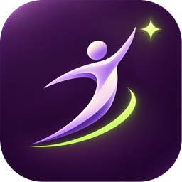
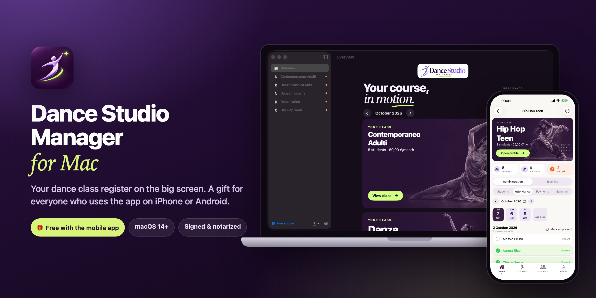
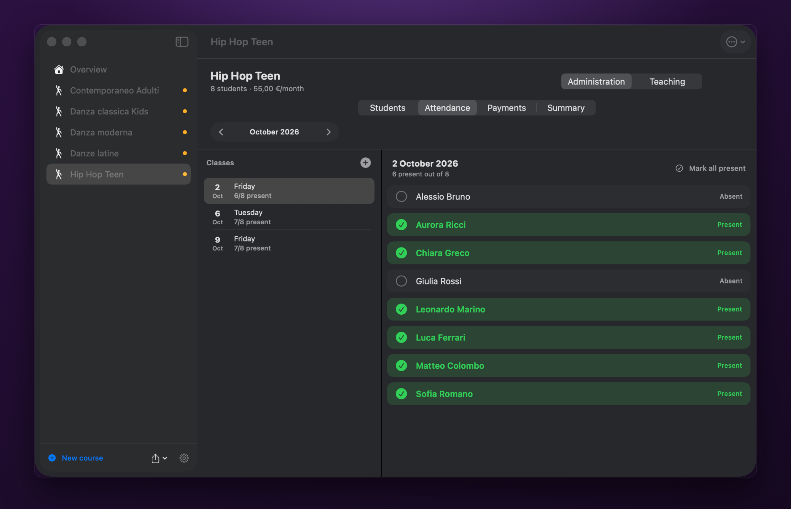
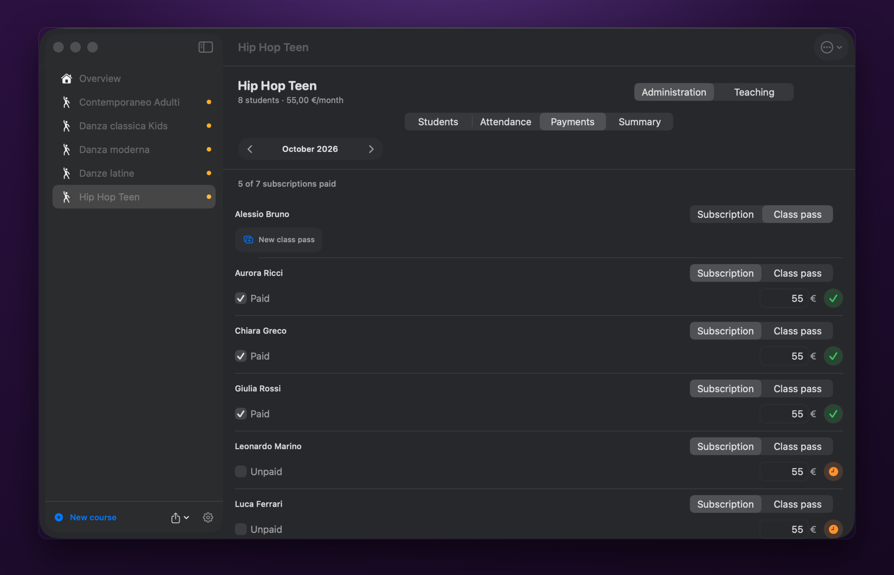
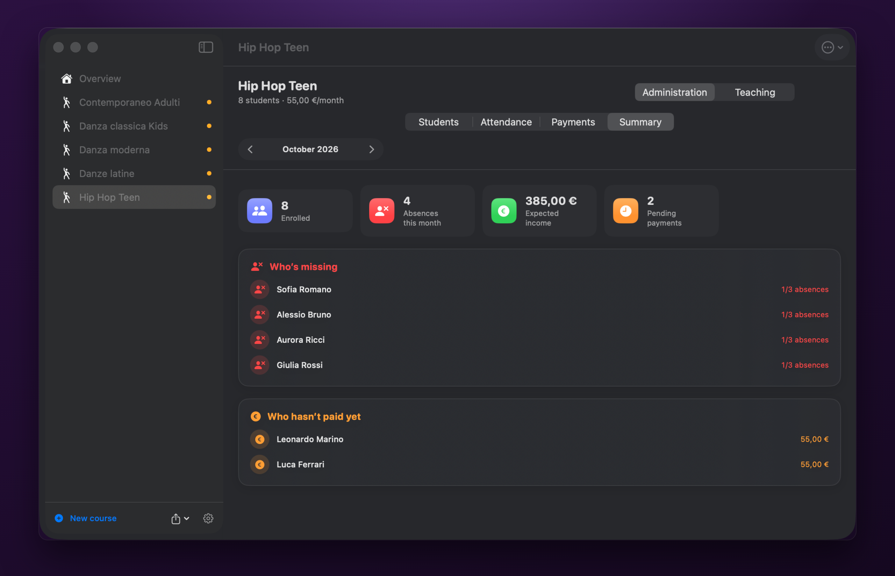
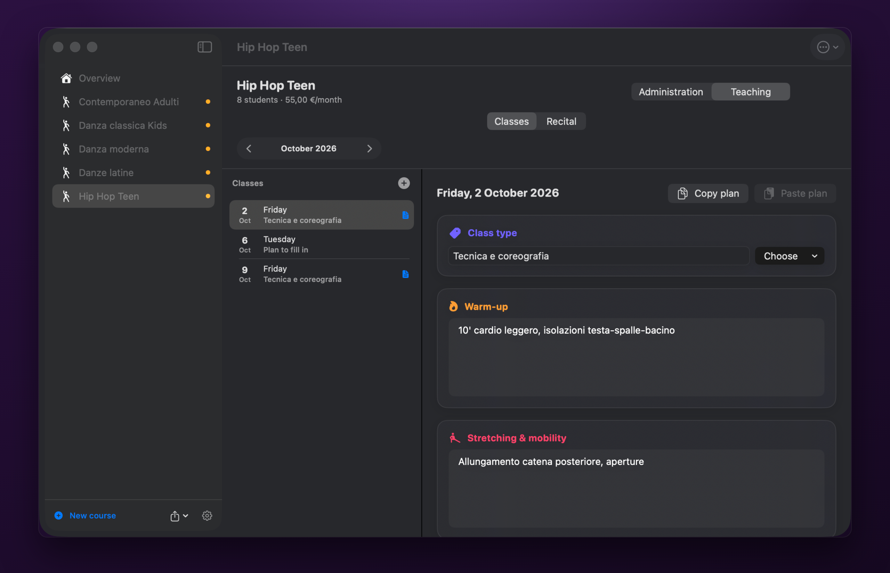
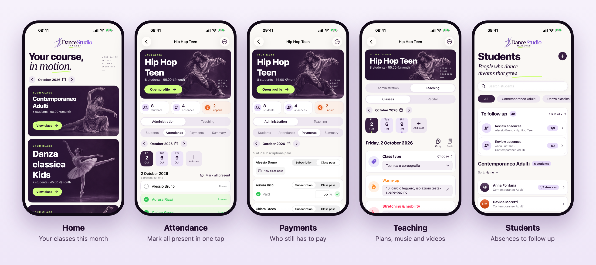
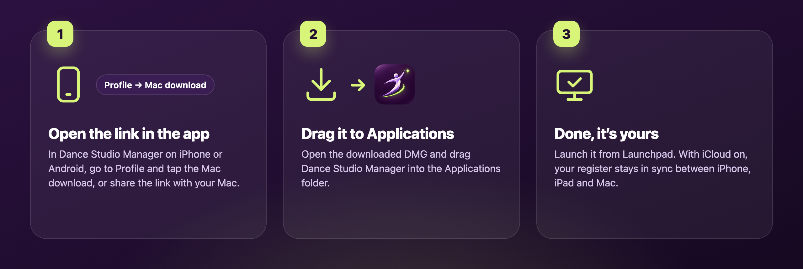

  

<h1 align="center">Dance Studio Manager for Mac</h1>

<a href="README.md">Italiano</a> · <b>English</b>

  <b>Your dance class register, now on your Mac's big screen.</b> 
  Attendance, payments, lesson plans and recital, always in order. 
  🎁 A free gift for everyone who uses Dance Studio Manager on iPhone or Android.

  
  
  

  

---

## A gift for app users

Already have **Dance Studio Manager** on your phone? The Mac version is **free**: the download
link is reserved for customers and is only inside the app. You get the same register on a big
screen, handy for planning classes, checking the month's payments or printing a report.

- 📱 **iPhone and iPad**: [Dance Studio Manager on the App Store](https://apps.apple.com/app/dance-studio-manager/id6815791566)
- 🤖 **Android**: Dance Studio Manager on Google Play (coming soon)

In the iPhone or Android app, the download link is in **Profile → The Mac app is a gift**.

## What it does

Designed by a dance teacher, for dance teachers.

- ✅ **Attendance in one click.** Add the month's classes and click a name to mark who's there: the
  row turns green. "Mark all present" with a single button.
- 💶 **Payments under control.** Monthly subscription or class pass: see at a glance who is up to
  date and who still has to pay. For classes whose payments are handled by the front desk, track
  attendance only.
- 📋 **To do, month by month.** The summary gathers absences to review and pending payments from
  all your classes, with the expected income.
- 🩰 **A plan for every class.** Warm-up, stretching, choreography and across-the-floor notes, links
  to music (Spotify, YouTube…) and rehearsal videos. Copy a plan and paste it onto another class.
- 🎭 **The recital.** Show title and date, music, costumes, choreographies and expenses in one place.
- 🔒 **Your data, safe.** No account and no ads. Automatic backups after every change and a PDF
  report to print or share.
- ☁️ **iCloud sync** between iPhone, iPad and Mac with the same Apple Account.
- 🌗 Light and dark theme, in **English and Italian**.

## On the Mac

  
   <b>Attendance in one click</b> · mark who's there, the row turns green

<table>
  <tr>
    <td width="50%" align="center"> <b>Payments</b> · subscription or class pass</td>
    <td width="50%" align="center"> <b>Summary</b> · who's missing and who hasn't paid</td>
  </tr>
</table>

  
   <b>A plan for every class</b> · warm-up, stretching, choreography

## On your phone

The same register, always in your pocket.

  

## How to install

  

1. **Open the app on your phone**, go to **Profile → The Mac app is a gift** and tap
   **Share the link with your Mac** (or **Download for Mac for free** if you're already on the Mac).
2. **Open the DMG** and drag **Dance Studio Manager** into the **Applications** folder.
3. **Launch the app** from Launchpad or the Applications folder. Done!

> The app is signed with a Developer ID and **notarized by Apple**, so it opens without warnings.

## Requirements

- A **Mac** running **macOS 14 Sonoma** or later.
- Works on both **Apple Silicon** (M1 and later) and **Intel** Macs.

## FAQ

<b>Is it really free?</b>

Yes. The Mac version is a gift for Dance Studio Manager users on iPhone or Android: the private
link is inside the app, so you download it and use it without paying anything or creating an account.

<b>How do I get my iPhone data onto the Mac?</b>

If **iCloud sync** is on in the iPhone app (Profile → Sync), just use the same Apple Account on the
Mac: attendance, payments, lesson plans and recital update on their own. Rehearsal videos stay on
the device where you added them.

<b>What if I use the Android app?</b>

Export a backup from the Android app and, on the Mac, use **Import data backup…**: the backup
format is compatible. Rehearsal videos must be transferred separately.

<b>macOS says the app can't be opened</b>

Make sure you copied it into the **Applications** folder and that you're on macOS 14 or later. If
the problem persists, open System Settings → Privacy & Security and choose **Open Anyway**.

<b>Where does my data go?</b>

It stays on your Mac (and in your iCloud, if you turn on sync). No data is sent to us or to third
parties. Read the [privacy policy](https://massimopozzi1989-gif.github.io/dance-studio-manager-privacy/).

---

Made with ❤️ in Italy by Massimo Pozzi · More dance, people, stories, every day

