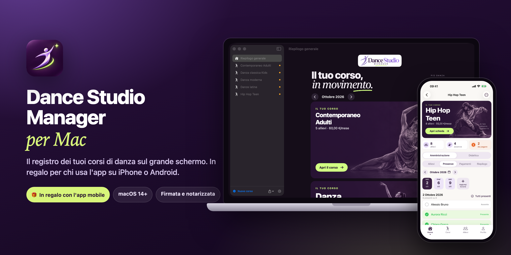
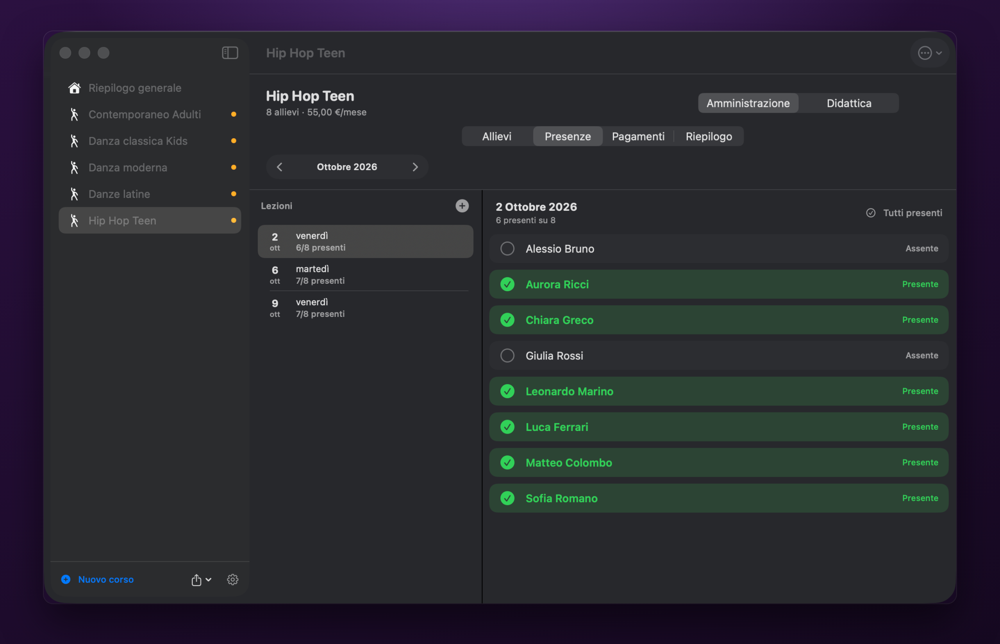
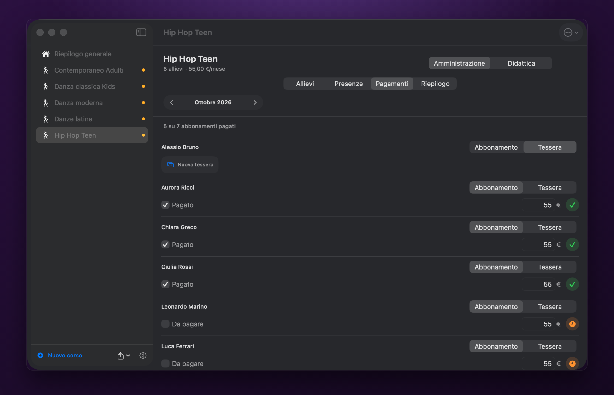
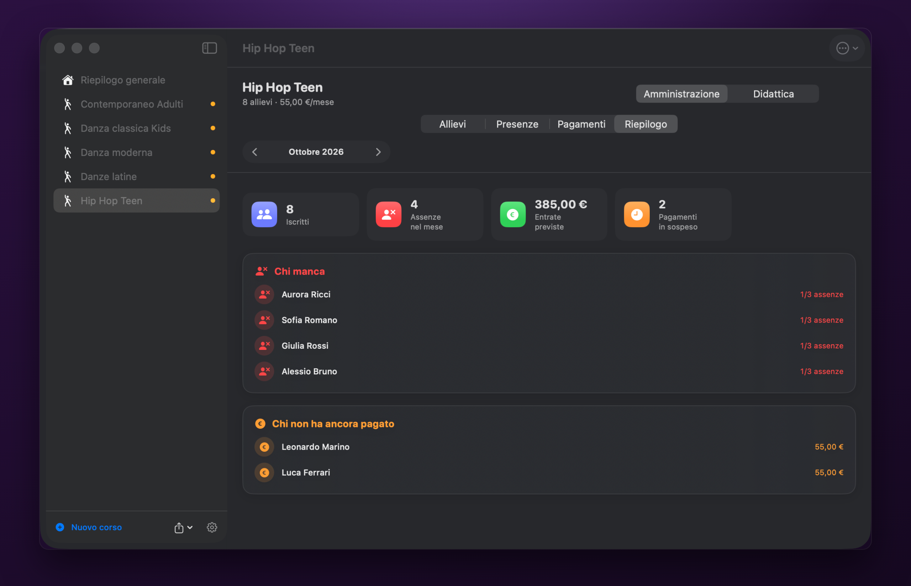
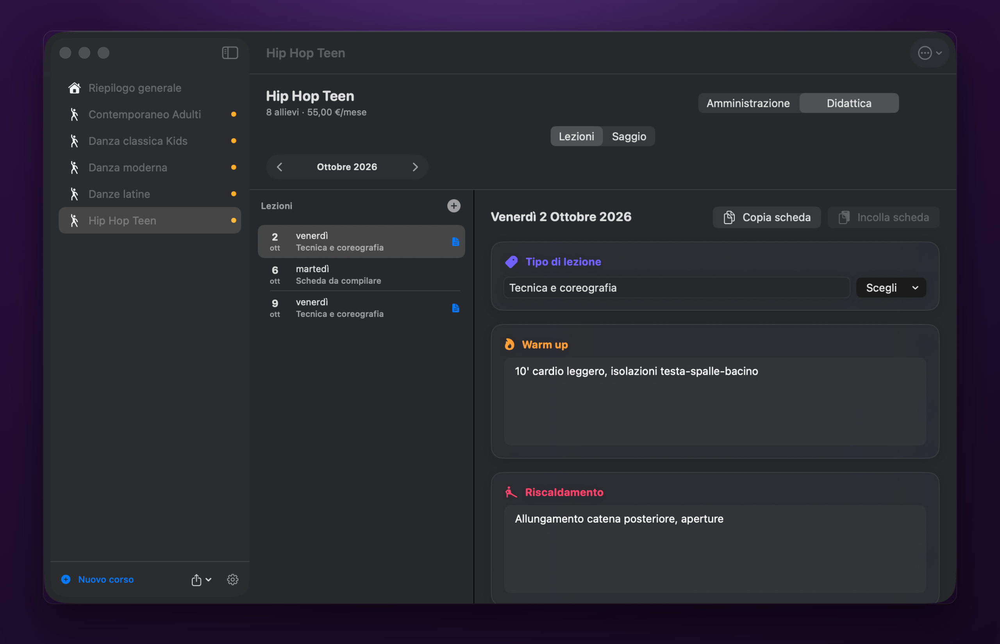
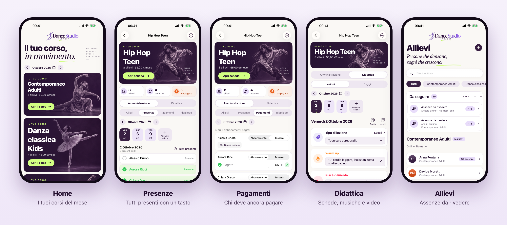
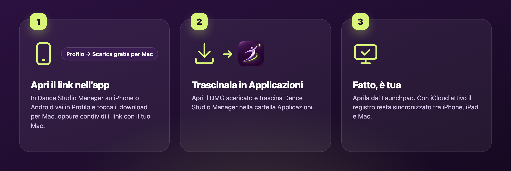

  

<h1 align="center">Dance Studio Manager per Mac</h1>

<b>Italiano</b> · <a href="README.en.md">English</a>

  <b>Il registro dei tuoi corsi di danza, ora anche sul grande schermo del Mac.</b> 
  Presenze, pagamenti, schede lezione e saggio, sempre in ordine. 
  🎁 In regalo per chi usa Dance Studio Manager su iPhone o Android.

  
  
  

  

---

## Un regalo per chi ha l'app

Hai già **Dance Studio Manager** sul telefono? La versione per Mac è **gratis**: il link per
scaricarla è riservato ai clienti e lo trovi solo dentro l'app. Ritrovi lo stesso registro su uno
schermo grande, comodo per preparare le lezioni, controllare i pagamenti del mese o stampare un report.

- 📱 **iPhone e iPad**: [Dance Studio Manager sull'App Store](https://apps.apple.com/it/app/dance-studio-manager/id6815791566)
- 🤖 **Android**: Dance Studio Manager su Google Play (in arrivo)

Nell'app per iPhone o Android trovi il link al download in **Profilo → La versione Mac è in regalo**.

## Cosa fa

Pensata da un insegnante per gli insegnanti di danza.

- ✅ **Presenze in un tocco.** Aggiungi le lezioni del mese e segna chi c'è cliccando il nome: la
  riga diventa verde. "Tutti presenti" con un solo tasto.
- 💶 **Pagamenti sotto controllo.** Abbonamento mensile o tessera a lezioni: vedi subito chi è in
  regola e chi deve ancora pagare. Per i corsi gestiti dalla segreteria puoi tenere solo le presenze.
- 📋 **Da gestire, mese per mese.** Il riepilogo raccoglie assenze da rivedere e pagamenti in
  sospeso di tutti i corsi, con le entrate previste.
- 🩰 **La scheda di ogni lezione.** Warm up, riscaldamento, coreografia e diagonale, i link alle
  musiche (Spotify, YouTube…) e i video delle prove. Copia e incolla la scheda su un'altra lezione.
- 🎭 **Il saggio.** Titolo e data dello spettacolo, musiche, vestiti, coreografie e spese in un
  unico posto.
- 🔒 **I tuoi dati, al sicuro.** Nessun account e nessuna pubblicità. Backup automatici dopo ogni
  modifica e report PDF da stampare o condividere.
- ☁️ **Sincronizzazione iCloud** tra iPhone, iPad e Mac con lo stesso account Apple.
- 🌗 Tema chiaro e scuro, in **italiano e inglese**.

## Sul Mac

  
   <b>Presenze in un tocco</b> · segna chi c'è, la riga diventa verde

<table>
  <tr>
    <td width="50%" align="center"> <b>Pagamenti</b> · abbonamento o tessera</td>
    <td width="50%" align="center"> <b>Riepilogo</b> · chi manca e chi non ha pagato</td>
  </tr>
</table>

  
   <b>La scheda di ogni lezione</b> · warm up, riscaldamento, coreografia

## Sul telefono

Lo stesso registro, sempre in tasca.

  

## Come installarla

  

1. **Apri l'app sul telefono**, vai in **Profilo → La versione Mac è in regalo** e tocca
   **Condividi il link con il tuo Mac** (oppure **Scarica gratis per Mac** se sei già sul Mac).
2. **Apri il DMG** e trascina **Dance Studio Manager** nella cartella **Applicazioni**.
3. **Avvia l'app** da Launchpad o dalla cartella Applicazioni. Fatto!

> L'app è firmata con Developer ID e **notarizzata da Apple**: si apre senza avvisi.

## Requisiti

- Un **Mac** con **macOS 14 Sonoma** o successivo.
- Funziona sia su Mac con **Apple Silicon** (M1 e successivi) sia su Mac **Intel**.

## Domande frequenti

<b>È davvero gratis?</b>

Sì. La versione per Mac è un regalo per chi usa Dance Studio Manager su iPhone o Android: il link
riservato è dentro l'app, la scarichi e la usi senza pagare nulla e senza creare account.

<b>Come porto sul Mac i dati che ho sull'iPhone?</b>

Se sull'iPhone è attiva la **sincronizzazione con iCloud** (Profilo → Sincronizzazione), sul Mac
basta usare lo stesso account Apple: presenze, pagamenti, schede lezione e saggio si aggiornano da
soli. I video delle prove restano sul dispositivo su cui li hai caricati.

<b>E se uso l'app su Android?</b>

Esporta un backup dall'app Android e, sul Mac, usa **Importa backup dati…**: il formato dei backup è
compatibile. I video delle prove vanno trasferiti a parte.

<b>macOS dice che l'app non si può aprire</b>

Assicurati di averla copiata nella cartella **Applicazioni** e di avere macOS 14 o successivo. Se il
problema resta, apri Impostazioni di Sistema → Privacy e sicurezza e scegli **Apri comunque**.

<b>I miei dati dove finiscono?</b>

Restano sul tuo Mac (e nel tuo iCloud, se attivi la sincronizzazione). Nessun dato viene inviato a
noi o a terzi. Leggi l'[informativa sulla privacy](https://massimopozzi1989-gif.github.io/dance-studio-manager-privacy/).

---

Fatto con ❤️ in Italia da Massimo Pozzi · Più danza, persone, storie, ogni giorno

